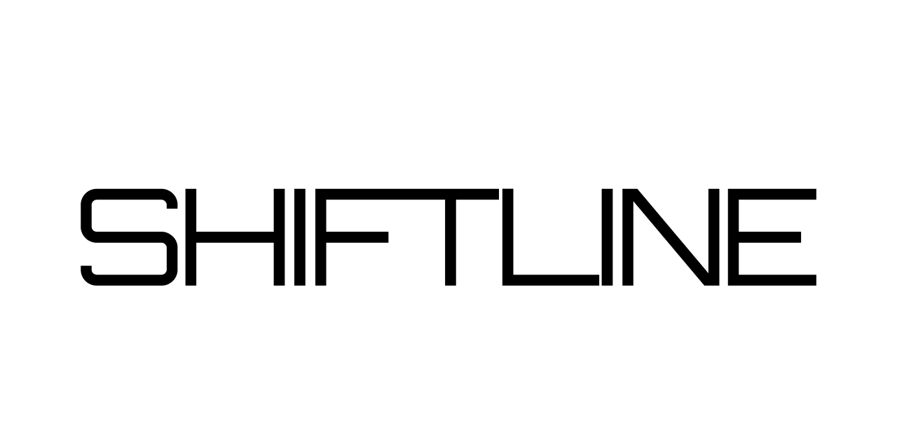

# Shiftline

<picture>
    <source media="(prefers-color-scheme: dark)"
            srcset="./docs/images/shiftline-dark.png">
    <source media="(prefers-color-scheme: light)"
            srcset="./docs/images/shiftline-light.png">
    
</picture>

---

<blockquote style="border-left: 4px solid #00AAFF; padding-left: 10px; color: #ffffff;">
    A fast-paced, retro-futuristic arcade racing game built for the JetBrains Academy Game Challenge.
</blockquote>

## Tech Stack

  

- **Framework & UI:** [Svelte](https://svelte.dev/)
- **3D Graphics Engine:** [Three.js](https://threejs.org/)
- **Language:** [TypeScript](https://www.typescriptlang.org/)
- **Audio & Music:** [Strudel](https://strudel.cc/)
- **IDE & AI Assistance:** [WebStorm](https://www.jetbrains.com/webstorm/) / [AIR](https://www.jetbrains.com/air/).

---
